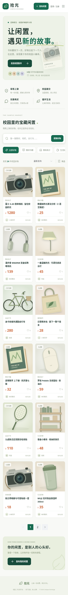
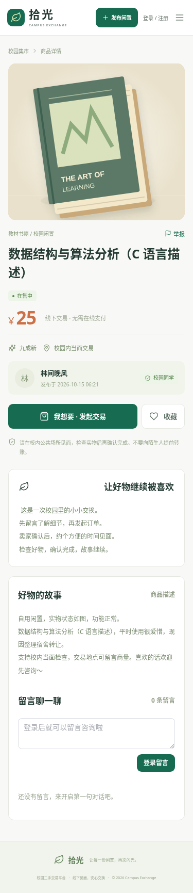
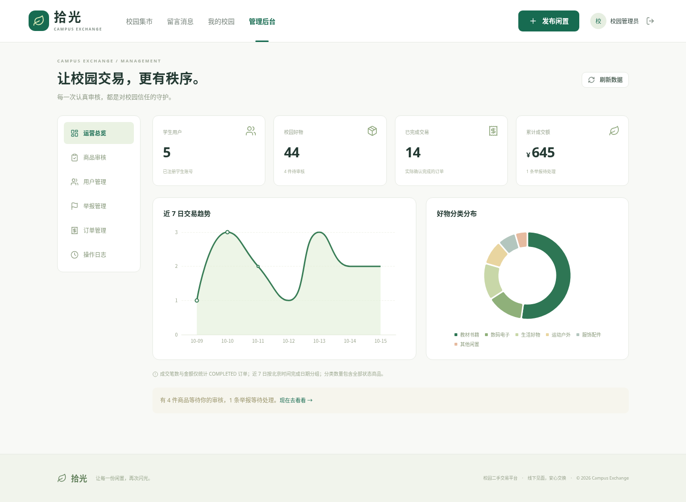
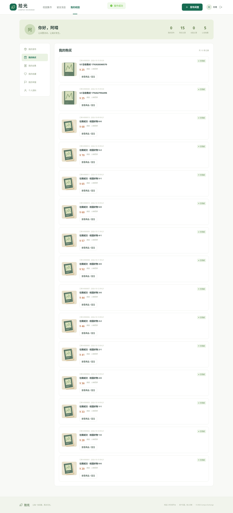

# 拾光校园二手交易平台——测试报告

测试日期：2026 年 10 月 15 日（北京时间）

## 1. 环境与范围

真实运行环境为 Debian 13、JDK 21.0.12.1、Maven 3.9.9、Node 24.19.0、MySQL 8.4.11、Chromium 154。云机器可见 5 个 CPU、33GiB 内存；MySQL 使用本机 Docker，HTTP 通过回环请求。测试没有使用模拟后端、内存数据库或静态接口替代。

范围包含 FR-01 至 FR-11：账号权限、商品审核、搜索分页、上传、收藏留言、订单、用户举报、管理看板。未测试真实支付、学籍验证或实时聊天，这些不在 V1.0 范围内。本机 Windows / IDEA 的最终环境仍应由提交者按运行指南复验。

## 2. 构建与启动

| 检查 | 结果 | 说明 |
| --- | --- | --- |
| Maven package | 通过 | 16 个 Java 源文件编译，生成可执行 Spring Boot JAR |
| Vite production build | 通过 | 页面按路由拆包，生成 dist |
| MySQL / Flyway | 通过 | 空库自动建 11 张业务表，重启校验迁移不重复初始化 |
| /api/health | 通过 | 数据库实际 SELECT 成功，database=up |
| 上传及样例图片 | 通过 | 本地路径经代理返回，浏览器实际显示 |

Maven 当前没有 JUnit 用例，构建日志中的“无测试”只代表编译完成。业务通过情况来自下列独立验收脚本。Vite 对 Element Plus / ECharts 的大依赖包有体积提示，构建成功；后续可按需要缩减组件引入。

## 3. 真实接口验收

命令：`python scripts/acceptance_test.py`。最终一次运行 **17 项通过，0 失败，0 错误**，耗时约 **5.82 秒**。每次创建唯一前缀测试账号和商品，不依赖其他用例的固定 ID。

| 编号 | 验证内容 | 结果 |
| --- | --- | --- |
| AT-01 / 01 | 注册后固定学生角色；普通账号管理接口 403；游客发布 401；错误密码拒绝 | 通过 |
| AT-02 / 02 | 上传后发布为 PENDING，卖家可见，访客及其他学生不可见 | 通过 |
| AT-03 / 03 | 审核后 LISTED，可按分类、关键词、价格、时间筛选和分页 | 通过 |
| AT-04 / 04 | 重复收藏不重复记录；取消正确；留言持久化；卖家回复；他人冒充回复拒绝 | 通过 |
| AT-05 / 05 | 下单→卖家接受→买家完成，商品 SOLD；卖家不能代完成、售出不能重售 | 通过 |
| AT-06 / 06 | 两条订单同时确认，恰好一条成功、另一条 409 且已取消，不发生双重预订 | 通过 |
| AT-07 / 07 | 看板成交总量、金额与已完成订单逐笔对照；近 7 日补齐 | 通过 |
| 08 | 他人编辑/下架拒绝，自购拒绝，越权订单操作拒绝 | 通过 |
| 09 | 拒绝订单不占用商品；已确认交易取消后恢复 LISTED | 通过 |
| 10 | 驳回保存原因，修改重提变 PENDING，再次通过清空原因 | 通过 |
| 11 | 非图片、危险后缀、MIME/内容不匹配、任意外链、无图商品均拒绝 | 通过 |
| 12 | 举报去重、处理结果、处理时间与审计记录可追溯 | 通过 |
| 13 | 封禁撤销已有会话，旧令牌不能访问，账号不能重新登录 | 通过 |
| 14 | 卖家下架后公开不可见，待确认订单取消，订单快照保留 | 通过 |
| 15 | 管理员强制下架同步取消已确认订单，之后不能确认完成 | 通过 |
| 16 | 资料持久化，非法分页/区间/日期返回 400，SQL 注入字符串不破坏查询 | 通过 |
| 17 | 退出后旧令牌不能使用 | 通过 |

并发用例通过 Python ThreadPoolExecutor 同时发出两个真实 HTTP 请求，实际执行 InnoDB 行锁与唯一索引约束；未通过串行模拟替代。

## 4. 浏览器验收

命令：`cd frontend` 后 `npx playwright test`。云环境使用系统 Chromium，最终 **2 条端到端场景通过，0 跳过，0 失败**，耗时约 **49.1 秒**。捕获页面 JavaScript 错误并断言为空。

场景一：访客首页加载 12 件商品、精确关键词搜索、商品详情、375×812 手机浏览；检查页面文档宽度不超过视口。场景二：三个独立浏览器上下文分别作为卖家、管理员、买家，完成上传、发布、待审核、通过、收藏、留言、刷新保持、下单、卖家确认、买家完成，最后断言商品已售出。

实际截图：

自动录屏见 `demo/`。这些为浏览器操作录屏，无讲解音轨；卖家、管理员、买家分别录制，保留操作时间关系。

## 5. 性能检查

先加载 `scripts/performance-fixture.sql`，在原有 24 件公开商品基础上补入 500 件性能样本，实际公开商品 **524 件**。随后运行 `python scripts/performance_test.py`，单客户端对 12 件/页的分页接口连续发起 30 次请求。

| 指标 | 实测 |
| --- | --- |
| 请求数 | 30 |
| 中位数 | 51.04 ms |
| P95 | 130.73 ms |
| 最大值 | 177.34 ms |
| 课程目标 | 3000 ms |
| 结果 | 所有请求低于目标，分页数量正确 |

测量包含 HTTP 和 JSON 解析，使用已经启动的 JVM、同机 MySQL 和本地网络，不代表跨校园网或高并发容量。临时性能样本在完成测量后清理，重跑可重新导入。此处未宣称开展压力测试。

## 6. 已发现并解决的问题

发布页价格输入组件默认整数步长与最低 0.01 不一致，浏览器原生校验曾阻止 25 元提交，已将步长设为 0.01。500 件商品时的移动分页曾横向溢出，已限制可见页码数。测试后完整浏览器流程重新执行通过。

云环境准备阶段遇到 Maven 代理与缓存目录问题，已在工作区外置配置解决。运行中的 JAR 曾受重新打包影响，已改为独立运行副本并重启，图片与交易重新验证成功。以上环境路径不写入本机 IDEA 配置。

## 7. 限制与交付建议

后台列表最多 500 条、审计和消息最多 200 条，适合课程规模；大规模应用需扩展分页。头像和商品图为本地存储，不包含自动孤立文件回收。已有订单保留快照；下架商品的详情不公开，可从订单记录查看原交易信息。当前未引入账号密码找回、真实学籍核验、实际付款或生产级限流。

正式提交前，按自己的 MySQL 账号和端口在 IDEA 复验；补齐姓名学号、课程封面与老师要求的格式；录制本人讲解版本。测试结果是本次云环境的实测证据，不代替尚未执行的本机复验。
