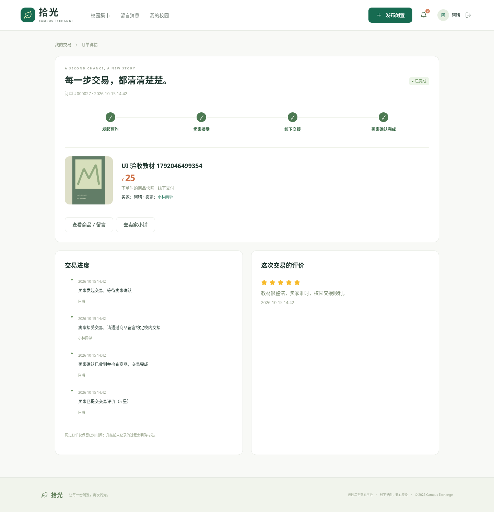
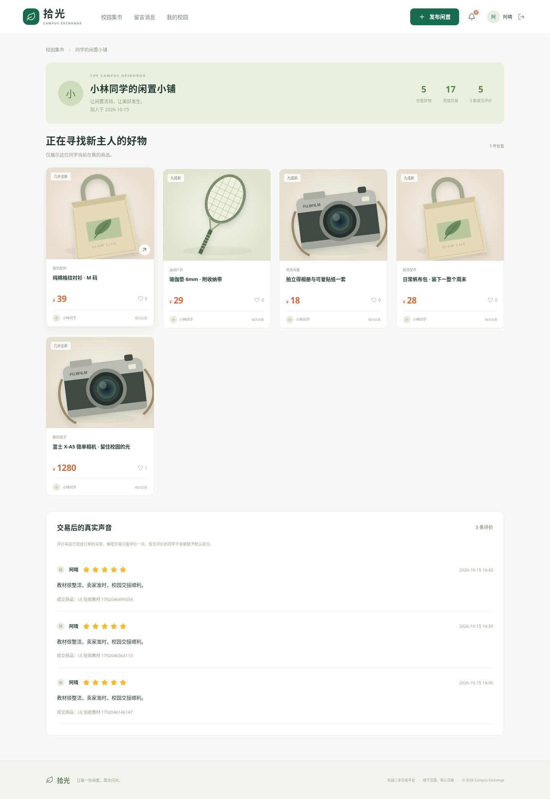

# 拾光校园二手交易平台——V1.1 测试报告

测试日期：2026 年 10 月 15 日（北京时间）

## 1. 环境与范围

真实运行环境为 Debian 13、JDK 21.0.12.1、Maven 3.9.9、Node 24.19.0、MySQL 8.4.11、Chromium 154。云机器可见 5 个 CPU、33GiB 内存；MySQL 使用本机 Docker，HTTP 通过回环请求。测试没有使用模拟后端、内存数据库或静态接口替代。

范围包含 FR-01 至 FR-15：原有账号与交易流程，以及规则推荐、卖家评价、订单事件、通知、分类公告、管理分页和区间统计。未测试真实支付、学籍验证或实时聊天，这些不在 V1.1 范围内。本机 Windows / IDEA 的最终环境仍应由提交者按运行指南复验。

## 2. 构建与启动

| 检查 | 结果 | 说明 |
| --- | --- | --- |
| Maven package | 通过 | 20 个 Java 源文件编译，生成可执行 Spring Boot JAR |
| Vite production build | 通过 | 页面按路由拆包，生成 dist |
| MySQL / Flyway | 通过 | 空库执行 V1/V2 建 15 张业务表；已有库从 V1 增量升级，原记录数量保持 |
| /api/health | 通过 | 数据库实际 SELECT 成功，database=up |
| 上传及样例图片 | 通过 | 本地路径经代理返回，浏览器实际显示 |

将最终免 npm 前端 ZIP 解压到无 frontend/node_modules 的新目录后，验证了 12 项页面/API/图片代理请求及 20 个静态资源，全部通过；实际连接 V1.1 后端与 MySQL，见 docs/evidence/ready-web-results.json。

Maven 当前没有 JUnit 用例，构建日志中的“无测试”只代表编译完成。业务通过情况来自下列独立验收脚本。Vite 对 Element Plus / ECharts 的大依赖包有体积提示，构建成功；后续可按需要缩减组件引入。

## 3. 真实接口验收

命令：`python scripts/acceptance_test.py`。最终一次运行 **25 项通过，0 失败，0 错误**，新空库运行耗时约 **13.70 秒**；旧库升级后的同套接口验收也全部通过（约 8.43 秒）。每次创建唯一前缀测试账号和商品，不依赖其他用例的固定 ID。

| 编号 | 验证内容 | 结果 |
| --- | --- | --- |
| AT-01 / 01 | 注册后固定学生角色；普通账号管理接口 403；游客发布 401；错误密码拒绝 | 通过 |
| AT-02 / 02 | 上传后发布为 PENDING，卖家可见，访客及其他学生不可见 | 通过 |
| AT-03 / 03 | 审核后 LISTED，可按分类、关键词、价格、时间筛选和分页 | 通过 |
| AT-04 / 04 | 重复收藏不重复记录；取消正确；留言持久化；卖家回复；他人冒充回复拒绝 | 通过 |
| AT-05 / 05 | 下单→卖家接受→买家完成，商品 SOLD；卖家不能代完成、售出不能重售 | 通过 |
| AT-06 / 06 | 两条订单同时确认，恰好一条成功、另一条 409 且已取消，不发生双重预订 | 通过 |
| AT-07 / 07 | 看板成交总量、金额与已完成订单逐笔对照；近 7 日补齐 | 通过 |
| 08 | 他人编辑/下架拒绝，自购拒绝，越权订单操作拒绝 | 通过 |
| 09 | 拒绝订单不占用商品；已确认交易取消后恢复 LISTED | 通过 |
| 10 | 驳回保存原因，修改重提变 PENDING，再次通过清空原因 | 通过 |
| 11 | 非图片、危险后缀、MIME/内容不匹配、任意外链、无图商品均拒绝 | 通过 |
| 12 | 举报去重、处理结果、处理时间与审计记录可追溯 | 通过 |
| 13 | 封禁撤销已有会话，旧令牌不能访问，账号不能重新登录 | 通过 |
| 14 | 卖家下架后公开不可见，待确认订单取消，订单快照保留 | 通过 |
| 15 | 管理员强制下架同步取消已确认订单，之后不能确认完成 | 通过 |
| 16 | 资料持久化，非法分页/区间/日期返回 400，SQL 注入字符串不破坏查询 | 通过 |
| 17 | 退出后旧令牌不能使用 | 通过 |

新增验收：

| 编号 | 验证内容 | 结果 |
| --- | --- | --- |
| 18 | 冷启动与收藏后推荐、评分理由、排除本人/已收藏/待审核商品 | 通过 |
| 19 | 未完成禁止评价、非买家禁止、非法评分拒绝、并发评价仅一条成功、卖家页聚合与时间线 | 通过 |
| 20 | 审核通知持久化、他人不能标记、单条与全部已读 | 通过 |
| 21 | 分类新增、前台联动、停用阻止新发布、历史保留、引用删除保护 | 通过 |
| 22 | 公告草稿隔离、发布公开、编辑删除与权限 | 通过 |
| 23 | 管理分页无重复、总数、非法页码/大小拒绝 | 通过 |
| 24 | 日期区间补零、空区间正确、非法日期和过长区间拒绝 | 通过 |
| 25 | 商品下架自动取消时，同步生成订单进度和通知 | 通过 |

并发用例通过 Python ThreadPoolExecutor 同时发出两个真实 HTTP 请求，实际执行 InnoDB 行锁与唯一索引约束；未通过串行模拟替代。

## 4. 浏览器验收

命令：`cd frontend` 后 `npx playwright test`。云环境使用系统 Chromium，最终 **3 条端到端场景全部通过，0 跳过、0 失败、0 重试**，耗时约 **67.88 秒**（见 docs/evidence/browser-summary.json）。捕获页面 JavaScript 错误并断言为空。

场景一：访客首页加载推荐、热门和 12 件集市商品，展开推荐说明、精确关键词搜索、商品详情、375×812 手机浏览；检查页面文档宽度不超过视口。场景二：三个独立浏览器上下文分别作为卖家、管理员、买家，完成上传、发布、待审核、通过、收藏、留言、刷新保持、下单、卖家确认、买家完成，随后打开订单时间线、发布评价、刷新验证、查看卖家页评价及手机通知，并断言商品已售出。场景三：新增分类、发布公告到前台、查看公告全文、选择空统计区间、375px 管理看板、管理商品翻页。

实际截图：

新增订单进度和卖家页截图：

自动录屏见 `demo/`。这些为浏览器操作录屏，无讲解音轨；卖家、管理员、买家分别录制，保留操作时间关系。

## 5. V1.0 留存的性能基线（V1.1 未重测）

先加载 `scripts/performance-fixture.sql`，在原有 24 件公开商品基础上补入 500 件性能样本，实际公开商品 **524 件**。随后运行 `python scripts/performance_test.py`，单客户端对 12 件/页的分页接口连续发起 30 次请求。

| 指标 | 实测 |
| --- | --- |
| 请求数 | 30 |
| 中位数 | 51.04 ms |
| P95 | 130.73 ms |
| 最大值 | 177.34 ms |
| 课程目标 | 3000 ms |
| 结果 | 所有请求低于目标，分页数量正确 |

测量包含 HTTP 和 JSON 解析，使用已经启动的 JVM、同机 MySQL 和本地网络，不代表跨校园网或高并发容量。临时性能样本在完成测量后清理，重跑可重新导入。此处未宣称开展压力测试。

## 6. 已发现并解决的问题

V1.1 浏览器复测发现，管理统计图在桌面切换至手机宽度时，画布调整前会造成短暂横向溢出；已给图表容器增加宽度约束与溢出裁切，并重跑管理流程。

发布页价格输入组件默认整数步长与最低 0.01 不一致，浏览器原生校验曾阻止 25 元提交，已将步长设为 0.01。500 件商品时的移动分页曾横向溢出，已限制可见页码数。测试后完整浏览器流程重新执行通过。

云环境准备阶段遇到 Maven 代理与缓存目录问题，已在工作区外置配置解决。运行中的 JAR 曾受重新打包影响，已改为独立运行副本并重启，图片与交易重新验证成功。以上环境路径不写入本机 IDEA 配置。

## 7. 限制与交付建议

后台列表现已全部分页；个人消息仍最多 200 条，个人商品/订单/收藏/举报仍返回完整列表。推荐目前对全部符合条件商品评分，适合课程规模；未做大规模推荐性能和准确率评估。头像和商品图为本地存储，不包含自动孤立文件回收。已有订单保留快照；下架商品的详情不公开，可从订单记录查看原交易信息。当前未引入账号密码找回、真实学籍核验、实际付款或生产级限流。

正式提交前，按自己的 MySQL 账号和端口在 IDEA 复验；补齐姓名学号、课程封面与老师要求的格式；录制本人讲解版本。测试结果是本次云环境的实测证据，不代替尚未执行的本机复验。

## 8. 数据迁移证据

升级前后 app_user=6、goods=45、trade_order=16、favorite=6、message=5，均保持不变，Flyway 从 1 条迁移变为 2 条。随后在独立 campus_exchange_verify 空库执行 V1/V2，自动生成演示数据，再运行接口与浏览器验收。迁移摘要见 docs/evidence/upgrade-migration.json。仅对本次云环境声明结果，未宣称已在用户的 Windows 电脑执行。
