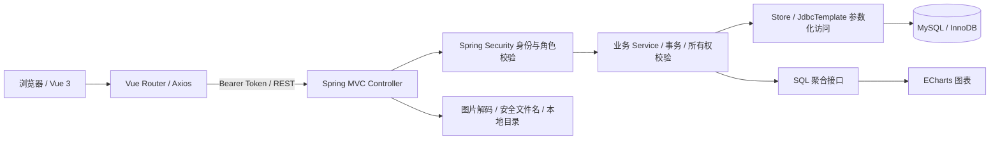
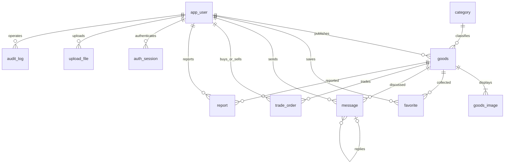
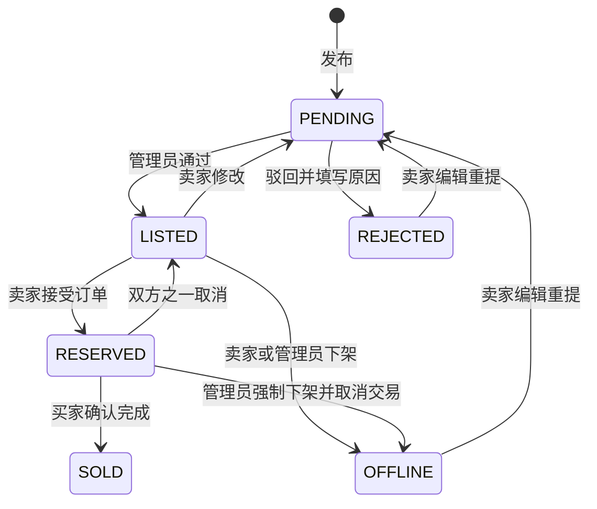
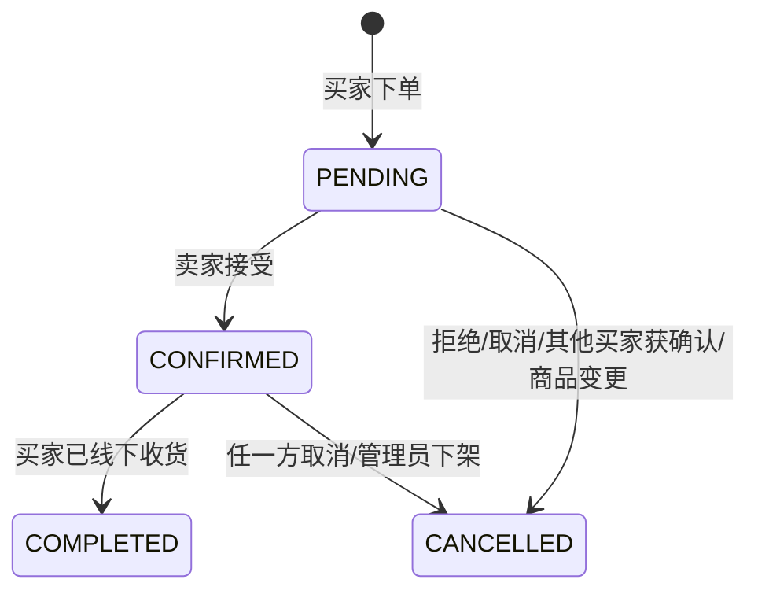

# 拾光校园二手交易平台——需求与系统设计报告

课程：________　姓名：________　学号：________　班级：________

版本：V1.0　日期：2026 年 10 月 15 日（北京时间）

## 1. 项目背景与目标

高校学生经常需要转让教材、电子配件、生活用品。群聊方式存在信息分散、成交状态不明确、缺少运营审核的问题。本项目通过统一商品入口、收藏咨询和线下订单形成可演示的交易闭环。

系统采用浏览器访问，分为访客、学生、管理员。当前基线来自《Campus Exchange 校园二手交易平台 软件需求分析 V1.0》。需求可随课程反馈迭代；本版不包含真实支付、学校身份验证、物流、WebSocket 或推荐算法。

## 2. 功能需求与追踪

| 编号 | 功能 | 实现位置 | 验收方式 |
| --- | --- | --- | --- |
| FR-01 | 注册、登录、退出、资料、权限 | AuthService、SecurityConfig、Auth/Personal 页面 | AT-01、接口 01/13/16/17 |
| FR-02 | 列表、分类、搜索、区间、时间、详情 | GoodsService.browse/detail、Market/Detail | AT-03、浏览器访客流程 |
| FR-03 | 上传、发布、编辑、下架 | UploadController、GoodsService.save/offline、Publish | AT-02、接口 08/10/11/14 |
| FR-04 | 收藏与取消、收藏列表 | favorite 唯一键、Personal | AT-04 |
| FR-05 | 咨询、卖家回复、个人消息 | message 自关联、Messages/Detail | AT-04、浏览器留言持久化 |
| FR-06 | 下单、同意、拒绝、取消、完成 | OrderService、trade_order | AT-05、AT-06、接口 09/15 |
| FR-07 | 发布、买卖、收藏、个人资料 | /me 接口、Personal | 浏览器多账号交易 |
| FR-08 | 审核、驳回原因、强制下架 | AdminService.review、Admin | AT-03、接口 10/15 |
| FR-09 | 用户禁用、举报及处理留痕 | report、audit_log、Admin | 接口 12/13 |
| FR-10 | 买卖方、日期、状态查询订单 | AdminService.orders | 管理端筛选、接口统计交叉验证 |
| FR-11 | KPI、分类、7 日趋势 | AdminService.dashboard、ECharts | AT-07、浏览器图表渲染 |

非功能目标包括密码单向哈希、后端角色/所有权验证、参数化 SQL、防脚本注入、图片实际内容校验、分页、375px 手机浏览与配置外置。

## 3. 总体架构

前端负责交互与表单提示；后端负责最终校验与规则；数据库保存业务状态和唯一约束。后端按 Controller、Service、Repository 分层。Repository 使用 Spring JDBC 而非 MyBatis Mapper，仍保留相同的分层职责。

开发时 Vite 将 API 和图片路径转发到 8080，避免跨域配置。前端生产构建与后端 JAR 分开生成。MySQL 可通过本机安装或 Docker Compose 运行。

## 4. 页面与交互

学生端采用绿色、米白和少量橙色价格，体现校园循环生活。公共导航包含集市、留言、个人中心、发布。首页重点呈现搜索、六类入口与商品卡片。商品详情展示实物图、成色、卖家、收藏、线下下单和留言。

| 路由 | 页面 | 访问规则 |
| --- | --- | --- |
| / | 校园集市 | 所有人；只显示正常卖家在售商品 |
| /goods/:id | 商品详情与留言 | 已公开商品可浏览；私人状态仅卖家/管理员 |
| /login、/register | 账号 | 公开 |
| /publish、/edit/:id | 发布/编辑 | 登录；后端校验所有者 |
| /me?tab=... | 发布/买卖/收藏/举报/资料 | 当前账号 |
| /messages | 相关留言 | 当前账号 |
| /admin?tab=... | 六类管理页面 | 管理员；前后端双重限制 |

页面处理加载、请求失败、空记录和操作反馈。桌面采用四列卡片，手机两列；导航折叠，后台表格可横向滚动。

## 5. 数据库设计

数据库为 `campus_exchange`，字符集 utf8mb4，表使用 InnoDB。金额 `DECIMAL(10,2)`，业务时间 `DATETIME`，统一按北京时间解释。用户表采用 `app_user` 避免保留词歧义。

| 表 | 关键字段与约束 |
| --- | --- |
| app_user | username 唯一；password_hash；nickname/avatar/bio；role/status |
| category | name、icon、sort_order、status |
| goods | seller/category 外键；价格、成色、描述、状态、驳回原因、时间 |
| goods_image | goods_id、image_url、sort_order，多图按序读取 |
| favorite | (user_id,goods_id) 唯一，重复收藏幂等 |
| message | sender、goods、reply_to 自关联、内容；回复对象必须同商品 |
| trade_order | buyer/seller/goods；价格、标题和图片快照；状态与完成时间 |
| report | 举报人、商品、原因、处理状态、结果、管理员和处理时间 |
| audit_log | 管理员、目标、操作、说明、时间 |
| auth_session | SHA-256 令牌摘要、用户、7 日过期时间 |
| upload_file | 上传归属、生成路径和时间 |

索引包括商品 `(status,category_id,created_at)`、卖家索引，买家/卖家订单状态索引和商品留言索引。`active_goods_id` 生成列仅在订单状态为 CONFIRMED 时取 goods_id，其余为 NULL；该列唯一索引使同一商品最多存在一条已确认订单。

完整字段以 `V1__schema.sql` 为准。Flyway 自动执行，后续结构修改必须新增迁移，不修改已生效迁移。

## 6. 状态设计和业务事务

### 6.1 商品

私有商品不能通过公开列表或详情泄露。已预订/已售出商品不能编辑；卖家须先取消已确认订单后再下架。修改已上架商品后重新审核并取消旧的待确认订单，防止价格变化影响未确认交易。

### 6.2 订单

买家只能购买正常卖家在售的他人商品。同一买家不能重复建立同商品的待处理订单。允许多个买家先咨询下单，但仅一个能够得到卖家确认。

确认操作在一个数据库事务中执行：先 `SELECT goods ... FOR UPDATE`，再锁订单；检查商品为 LISTED 且订单为 PENDING；商品改为 RESERVED，订单改为 CONFIRMED；取消其他 PENDING 订单；一起提交。所有订单转换和商品编辑统一遵循“商品→订单”的锁顺序，减少死锁风险。唯一索引提供第二层约束。重复点击、非法转换返回 HTTP 409，不产生重复成交。

完成只能由对应买家执行，同时写入完成时间与 SOLD 商品状态。取消已确认订单将商品恢复 LISTED。强制下架则同时取消未完成订单并保留历史记录。管理员只有查询和违规处置权限，不能替用户确认交付。

### 6.3 举报与账号

举报在 PENDING、RESOLVED、REJECTED 之间流转，处理必须提供结果并写审计。相同用户对同一商品不能重复建立待处理举报。处理记录和商品下架分开操作、分别留痕。

禁用账号立即删除已有令牌；禁用账号不能再次登录，商品不再对公众展示。存在 CONFIRMED 交易的用户先完成/取消交易后再禁用，避免封禁导致履约悬空。管理员账号受保护。

## 7. 安全与隐私

密码使用 BCrypt（cost 10），从不返回 password_hash。登录使用 256 位随机不透明令牌，数据库只保存 SHA-256 摘要；默认 7 日过期，退出撤销。令牌存在 sessionStorage，不放 URL。

Spring Security 处理认证和管理员角色，Service 再次检查卖家/买家归属。注册忽略客户端伪造角色，统一创建 STUDENT。请求 DTO 使用 Bean Validation；SQL 参数不拼接用户输入，排序采用白名单。

Vue 使用文本插值显示留言和描述，不使用 v-html。图片仅支持 JPEG/PNG，检查扩展名、声明 MIME、实际解码格式及像素上限，再重新编码为 PNG，使用 UUID 文件名。每张输入 ≤5MB、≤1200 万像素，商品 1–5 张；图片必须是本人上传或原商品已有图片。上传资源不作为代码执行。

系统不采集学生学号、手机号或宿舍门牌，面交地点由双方通过留言约定。演示账号仅为课程本地运行。真实共享部署需要 HTTPS、账号治理、登录限速、上传存储配额和备份等进一步工作。

## 8. 统计口径

学生数不包括管理员。商品数包括全部状态，分类图也包括全部状态。成交笔数和金额仅包括 COMPLETED 的订单，金额使用订单快照。7 日趋势按北京时间的 completed_at 分组，空日期补零。待审核和待举报计数单独展示，避免和成交指标混淆。

## 9. 部署、测试与交付

运行前创建空 MySQL 库，Flyway 建表；DemoData 在空用户表上一次性生成演示数据。配置外置，可从 IDEA 环境变量注入。上传文件和数据库命名卷在重启后保留，服务进程需重新启动。

测试使用真实 HTTP + MySQL 的 17 项验收脚本，以及 Playwright 浏览器集成流程。性能样本可选装入 500 件商品，运行 30 次分页测量。具体实测结果、截图和录屏见测试报告与演示资料；不以静态界面或零测试 Maven 构建代替业务验证。

交付内容为前后端源码、版本化数据库 SQL、演示数据/账号、运行说明、本设计报告、接口说明、测试报告、截图、浏览器自动录屏及答辩提纲。学校封面、姓名学号和最终录音讲解需由提交者补齐。

## 10. 后续迭代

优先根据老师反馈调整字段、分类和报告格式。可在基础流程稳定后增加评价与卖家信用、站内通知、简单分类热度推荐。即时聊天与真实支付属于单独迭代，不影响本版线下交易规则。
